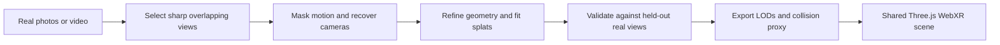

# Improving realistic VR reconstruction from photographs

Research and repository review: **October 24, 2026**.

## Recommendation

Change the strategy from “complete every photograph into procedural bodies and a walkable room” to **selecting a reconstruction method based on the evidence available and the experience requested**.

The existing application is a useful delivery platform. Keep its media archive, search, multiplayer rooms, navigation, provenance, caching, and asset validation. Replace the reconstruction and appearance stages incrementally.

The first comparison should have three candidates:

1. **Faithful photo experience:** calibrated layered geometry or predicted splats, retaining the original pixels, with a tested range of head movement. This is the default candidate for irreplaceable single photographs and recognizable people.
2. **Explorable generated world:** a hosted image-to-world model, initially World Labs Marble, rendered as splats plus collision geometry. This is the fastest experiment for a much more convincing environment from one image, accepting that hidden content is imagined.
3. **Captured reconstruction:** overlapping real photographs or selected video frames → camera recovery → optimized Gaussian splats. This is the preferred route to a faithful, freely explorable scene when the source coverage supports it.

For close-up people and interactive objects, add specialist reconstruction as a separate layer. A larger general image-to-3D model should not automatically replace the photographed person.

**Prioritize camera, pose, geometry, and view consistency before additional texture generation.** Better texture painted onto the wrong shape still looks wrong in stereo. A single photo cannot determine the original hidden surfaces uniquely; visual plausibility and fidelity to a memory must be evaluated separately.

This document proposes work. No new cloud generation or model comparison was executed during this review, and no application behavior was changed.

## 1. What the repository actually does

The review covered the implementation, reconstruction documentation, the two cached world manifests, the saved front/side/rear screenshots, and the existing neural trial diagnostics. Saved screenshots are historical output, not a new headset test.

| Stage | Current implementation | Consequence for realism |
|---|---|---|
| Source preparation | [server/reconstruction.ts](../server/reconstruction.ts), lines 152–169: source JPEG up to 1600 px; DA V2 Small input up to 518 px; saved grayscale depth up to 256 px | Fine geometry and boundary detail are lost before rendering |
| Camera and depth | Same file: fixed FOV 60°, near/far 2–12; [src/scene/reconstruction.ts](../src/scene/reconstruction.ts) interprets normalized depth | These are artistic units, not recovered meters; perspective and stereo scale can be wrong |
| Segmentation | [server/world-completion.ts](../server/world-completion.ts): Gemini polygons → local DETR → depth-component fallback | Useful separation, but coarse masks do not preserve hair, fingers, and difficult overlaps reliably |
| People | [src/scene/human-body.ts](../src/scene/human-body.ts), especially lines 117–170: prescribed anatomy and limb coordinates with photo-fitted appearance | The original pose is replaced; a rounded head silhouette does not reconstruct facial depth |
| Arrangement | [src/scene/human-layout.ts](../src/scene/human-layout.ts), lines 42–67: approximate head-derived scale, minimum 0.76 spacing, people placed around z = −3.8 | Original overlap, contact, perspective, and depth arrangement can change |
| Surroundings | [src/scene/photo-environment.ts](../src/scene/photo-environment.ts): assumed camera height/horizon and preset architecture | Photo projection cannot repair incorrect room or street geometry |
| Indoor panorama | Same file, `photoWeight` configuration: source-background contribution becomes zero when an indoor panorama exists | Generated surroundings replace observed background detail to avoid duplicate people |
| Texture mapping | [src/scene/texture-projection.ts](../src/scene/texture-projection.ts): orthographic projection, visibility buffers, row-based atlas registration | Existing visibility logic is valuable, but geometry and camera fitting remain approximate |
| Neural assets | [src/scene/volume-world.ts](../src/scene/volume-world.ts), lines 262–281: optional GLB loader with procedural fallback | There is an integration path, but neither cached world activates a neural asset |
| Video | [server/reconstruction.ts](../server/reconstruction.ts), line 101: extracts one opening frame | The app currently discards the strongest potential source of additional geometric evidence |

Both cached worlds use manually prepared imagegen body atlases and panoramas, covering seven people in total. These curated assets are not an automated full-body reconstruction pipeline for every upload.

The local TripoSR experiment did run. Its diagnostics report an inferred full-body atlas as input, 4,520 vertices, 9,036 triangles, and `approvedForApp: false`. The original run took about 145 seconds; the later approximately 12-second pass is not a fresh inference benchmark. The resulting mesh was not selected in either served manifest.

There is also an integration gap: `overlayPhotographsOnVertexColors` has tests but no runtime caller. Loading a generated GLB does not currently restore original-photo detail through that function. Simply calling it would still require camera/geometry registration and would tie image detail to vertex density.

During this review, `npm run typecheck` passed and **all 97 `npm test` tests passed**. These checks establish structural behavior, not photographic realism. Physical Quest performance and stereo quality remain unverified; the SpacetimeDB suite was not rerun for this document.

## 2. Compare the approaches by the experience they support

The judgments below are engineering expectations to test, not measured rankings on this repository.

| Approach | Inputs | Best outcome | Main limitation | Recommended role |
|---|---|---|---|---|
| Layered depth image / depth mesh | One photo | Recognizable photographic details with modest parallax | Hidden surfaces and large viewpoint changes remain weak | First fidelity baseline |
| Feed-forward single-image splats | One photo, camera metadata when available | Continuous nearby novel views with less hand-built geometry | Predicted scene is incomplete outside observed coverage | Challenger to the layered baseline |
| Generated world splats | Photo, panorama, or a few references | Coherent, broadly explorable surroundings | May alter identity, layout, text, and historical details | First broad-exploration experiment |
| Real multiview optimized splats | Overlapping photos or video of a sufficiently static scene | Strongest evidence for appearance and geometry across viewpoints | Needs coverage, successful camera solving, and motion handling | Preferred high-fidelity route |
| Scene geometry + specialist people/objects | One or more photos, masks, fitted cameras | Editable objects, better pose, explicit collisions and interaction | More assembly work; appearance and scale must agree | Targeted upgrades after the baseline comparison |
| Panorama only | Real or generated 360° image | Convincing distant surroundings while looking around | No correct translation parallax or stereo geometry | Background/fallback, not a full walkable scene |

Gaussian splats represent appearance using many oriented, translucent 3D primitives. They can preserve photographic complexity without modeling every leaf or garment fold as triangles. They still need correct geometry, coverage, and a suitable renderer; choosing splats does not itself solve reconstruction.

## 3. Path A: preserve the photograph and support limited movement

This path should compete against the current complete-body renderer on the existing portraits. Preserve the photographed pose and composition rather than immediately replacing people with neutral-standing bodies.

### Proposed pipeline

1. Preserve the highest-resolution original and all orientation/crop/resize transforms.
2. Estimate intrinsics, depth/points, and normals. Benchmark **MoGe-2** against **MoGe-3** with the same renderer. MoGe-2 offers metric geometry, normals, and intrinsics; MoGe-3 adds refinement for finer structures. Their exact checkpoint cards list MIT. Metric predictions are still learned estimates, so retain uncertainty and optional measured-scale calibration. [MoGe implementation](https://github.com/microsoft/MoGe), [MoGe-2 checkpoint](https://huggingface.co/Ruicheng/moge-2-vitl-normal), [MoGe-3 checkpoint](https://huggingface.co/Ruicheng/moge-3-vitl).
3. Use a dedicated instance mask model and boundary refinement. Keep separate people, hair edges, gaps between arms, and background layers. **SAM 2.1** is an Apache-2.0 baseline; **SAM 3/3.1** adds semantic instance discovery/tracking under the custom SAM License. Gemini can provide labels and prompts. [SAM 2](https://github.com/facebookresearch/sam2), [SAM 3](https://github.com/facebookresearch/sam3).
4. Split geometry at depth discontinuities and instance boundaries. Fill both color and geometry behind foreground silhouettes; RGB inpainting alone cannot fix disocclusion. Layered depth inpainting is an established approach for limited motion parallax. [3D Photography with Context-aware Layered Depth Inpainting](https://shihmengli.github.io/3D-Photo-Inpainting/).
5. Render the actual source view first, then evaluate left/right eyes and small translations. Increase the movement envelope only where the result remains convincing.
6. Retain distant panorama imagery for uncovered directions. Keep nearby furniture, people, and walls in depth-bearing representations.

**Apple SHARP** is a relevant scientific reference for steps 2–4: single-image Gaussian prediction for nearby views, rather than recovered 360° content. Its model license explicitly excludes product development and commercial use. Consequently, omit it from this application's implementation plan unless separate permission is obtained; a permitted scientific evaluation is a distinct activity. Its downloadable code does not establish product rights. [Official SHARP repository](https://github.com/apple-aiml-research/ml-sharp), [model license](https://github.com/apple-aiml-research/ml-sharp/blob/main/LICENSE_MODEL).

As an experiment, test head offsets of ±0.1 m and ±0.25 m, then progressively wider offsets. These are evaluation positions, not established safe ranges. Do not clamp or counteract tracked head motion to hide artifacts; restrict artificial locomotion, provide an explicit viewing area, and fade or transition gracefully when coverage ends.

**Success condition:** original faces, clothing, pose, and scene arrangement look more faithful than the current renderer in stereo over a documented viewing region. It is acceptable for this experience to offer less walking if the visible memory is much more convincing.

## 4. Path B: generate a coherent explorable world

### Start with a hosted comparison

World Labs exposes an asynchronous API for generating worlds from images and other inputs. Its published integration model is a close match for this app: run generation on the server, persist the result, and share the resulting scene with all participants. [World API announcement](https://www.worldlabs.ai/blog/announcing-the-world-api).

Request **`marble-1.1`** explicitly for the standard baseline; compare **`marble-1.1-plus`** later when a larger world is useful, rather than assuming Plus improves every scene. The current omitted-model default is still `marble-1.0`, and `marble-1.0-draft` is available for inexpensive workflow trials. Obtain splat assets and a collision mesh; test the exported result inside this app instead of judging only a provider's flythrough. [Supported API models](https://docs.worldlabs.ai/api/models), [API overview](https://docs.worldlabs.ai/api), [generation examples](https://docs.worldlabs.ai/api/world-generation-examples).

Import the returned `100k` and `500k` SPZ levels first. Preserve `semantics_metadata`: scale Gaussian centers **and sizes** by `metric_scale_factor`, apply `ground_plane_offset` to scaled center Y, then convert the provider's OpenCV axes to the renderer's convention. If sizes are stored logarithmically, add the logarithm of the factor. Check the collider's export convention and align it to the same world; do not blindly apply a transform twice. This is essential for eye height, avatar scale, and teleportation. Provider metric normalization is still not proof of the original room's measured dimensions. [SPZ integration specification](https://docs.worldlabs.ai/api/rendering-spz).

For the first experiment, compare two inputs per representative scene: the untouched photograph and a carefully masked environment-only version. Whole-scene generation might preserve visual coherence better; separate people might preserve recognizable appearance better. Neither outcome should be assumed in advance. Evaluate duplicate people and incorrect background completion in both variants.

Keep the original photograph as the reference. Mark the result as a generated reconstruction, and retain the exact input, model identifier, settings, and chosen candidate. Generated backs, additional rooms, and objects outside the photograph are hypotheses.

World Labs' newer Atlas direction is worth watching, but preview documentation and announcements do not establish access for this account. Keep the first integration on a documented, accessible export workflow. [Atlas announcement](https://www.worldlabs.ai/blog/atlas).

### Local/open-weight scene generation is a later option

**NVIDIA Lyra 2.0** and **Tencent HY-World 2.0** are relevant scene-generation research candidates, with a closer task fit than an isolated-object generator. Lyra's weights use NVIDIA's Internal Scientific Research and Development Model License; HY-World has custom geographic and usage restrictions, including exclusions for the EU, UK, and South Korea that also cover outputs. Keep them outside the default product pipeline pending an appropriate licensing/deployment decision. Open code does not mean unrestricted model weights. [Lyra 2.0](https://github.com/nv-tlabs/lyra/tree/main/Lyra-2), [HY-World 2.0](https://github.com/Tencent-Hunyuan/HY-World-2.0), [HY-World license](https://github.com/Tencent-Hunyuan/HY-World-2.0/blob/main/License.txt).

The engineering attraction is control over inference and assets. The cost is maintaining multiple model stages, GPU dependencies, view consistency, conversion, and optimization. Do not make local execution on the current laptop a prerequisite for the best visual result.

**Success condition:** a convincing environment in the actual headset, stable across nearby views, with recognizable observed content and an explicit distinction between generated plausibility and recovered evidence.

## 5. Path C: exploit real overlapping photos and video

This is the highest-priority route when additional real views exist. A set of unrelated photos of different places or moments is not automatically a multiview dataset.



1. Replace opening-frame extraction with timestamped candidate extraction. Select sharp, well-exposed frames with overlap and useful viewpoint change; avoid a large pile of near-identical frames.
2. Use **COLMAP** as a camera-solving baseline. Keep known intrinsics, lens distortion, and shared-camera information. Add **ALIKED + LightGlue** matching where helpful; evaluate the matcher rather than assuming that every frame will register. [COLMAP FAQ](https://colmap.github.io/faq.html), [LightGlue](https://github.com/cvg/LightGlue).
3. For sparse or difficult views, compare **DA3-BASE** or **VGGT-1B-Commercial** as learned initializers, followed by geometric checks and optional bundle adjustment. Camera recovery remains a hypothesis until projections agree with real observations. [Depth Anything 3 model table](https://github.com/ByteDance-Seed/Depth-Anything-3#-model-cards), [VGGT](https://github.com/facebookresearch/vggt).
4. Use **Nerfstudio Splatfacto** as an end-to-end training baseline, or build a worker around **gsplat** training examples; also evaluate the already-documented OpenSplat path. Camera recovery is a separate stage. Splatfacto documents approximate 6 GB/12 GB memory for its standard/big configurations, which makes a GPU trial more accessible than some generative pipelines, but actual use depends on the scene/settings. [Splatfacto](https://docs.nerf.studio/nerfology/methods/splat.html), [custom image/video processing](https://docs.nerf.studio/quickstart/custom_dataset.html), [gsplat](https://github.com/nerfstudio-project/gsplat), [OpenSplat](https://github.com/WebODM/OpenSplat).
5. Estimate a ground plane, align one shared coordinate frame, and calibrate scale with a known distance or reliable metric measurement. Ordinary RGB structure-from-motion alone does not recover absolute scale.
6. Export appearance and collision separately. A visually convincing splat cloud is not automatically a watertight walkable surface.

For newly captured static scenes, a slow walkthrough with sharp overlapping views and genuine camera translation is more valuable than only rotating in place. Coverage of both sides is required to recover both sides. Begin with a small static room or outdoor section before attempting crowds, mirrors, glass, or a full building.

Mask moving people out of the static camera solve and background optimization. Keep a selected person's original frozen appearance, use a separate human reconstruction, or explicitly undertake dynamic/4D reconstruction later. Combining every frame of a walking person in a static splat model creates ghosting and inconsistent geometry.

Generated frames can regularize or extend a scene, but must remain tagged as synthetic. Never count them as held-out real evidence or let a good fit to generated views establish historical accuracy.

## 6. Specialist people and object reconstruction

The existing portraits make this track important. Correcting pose and original-view alignment is likely more valuable than increasing the procedural mesh resolution.

### People

Use **SAM 3D Body** as a pose/shape/camera initialization candidate. It estimates body, hand, and foot pose using the Momentum Human Rig and accepts optional masks/keypoints; its demo already uses MoGe-2 for FOV estimation. It does **not** establish a textured, identity-accurate clothed avatar by itself. [SAM 3D Body](https://github.com/facebookresearch/sam-3d-body).

Fit each person back to the source using visible joints, silhouette, occlusion ordering, and contact constraints. A hand around a friend's shoulder should remain there. Do not separate people by a fixed minimum distance or scale every person to the same height.

For clothed surface reconstruction, compare **PSHuman** and **SiTH** on full or sufficiently visible people. PSHuman's documented 768-resolution pipeline requires over 40 GB VRAM; SiTH reports an RTX 3090 setup and uses SMPL-X. Their inferred back views still need identity and garment checks. Cropped group portraits are harder than clean isolated full-body inputs. [PSHuman](https://github.com/pengHTYX/PSHuman), [SiTH](https://github.com/SiTH-Diffusion/SiTH).

Preserve original facial and clothing pixels on correctly registered visible surfaces. Use high-resolution UV baking or projective texture layers, with depth visibility and angle weighting. Avoid converting all appearance to vertex colors; fine lettering and facial details then depend on mesh density. Test a layered photographic person as the fallback when a complete generated person loses likeness.

### Objects

For actual furniture or objects in clutter, evaluate **SAM 3D Objects** before treating every crop as a studio object. It predicts geometry, appearance, pose, and layout from an image plus mask and supports Gaussian output. Its official setup calls for Linux and at least 32 GB NVIDIA VRAM. [SAM 3D Objects](https://github.com/facebookresearch/sam-3d-objects), [setup requirements](https://github.com/facebookresearch/sam-3d-objects/blob/main/doc/setup.md).

**TRELLIS.2** is a reasonable general asset-generation comparison, with PBR output and a documented Linux/NVIDIA ≥24 GB setup. **Hunyuan3D 2.1** is another PBR candidate, but its documented combined shape/texture memory is 29 GB and its custom license has material deployment restrictions. Neither is a whole-room solution merely because it exports a GLB. [TRELLIS.2](https://github.com/microsoft/TRELLIS.2), [Hunyuan3D 2.1](https://github.com/Tencent-Hunyuan/Hunyuan3D-2.1).

An especially relevant research direction is **GenIA**: align a frozen generative object prior to observed geometry and appearance at inference time. Its October 2026 release supports single-image, multiview, and dynamic settings, but is CC BY-NC with additional third-party constraints. Treat it as a research comparison, not the default deployable dependency. [GenIA](https://github.com/facebookresearch/GenIA).

## 7. Mapping changes that benefit every path

### Establish one camera and coordinate model

Persist `fx`, `fy`, `cx`, `cy`, source dimensions, lens/undistortion metadata, source-to-working-image transform, and camera pose. Record whether depth is camera-Z or ray distance, and whether units are estimated meters or relative values.

For camera-Z depth, use `p_camera = z * inverse(K) * [u, v, 1]`. Convert coordinate conventions once into the Three.js world frame. Use that same frame for geometry, texture projection, source-view evaluation, collision, and multiplayer poses. A focal estimate must be rescaled after resizing/cropping; a good model with the wrong intrinsics still produces warped geometry.

In particular, MoGe's output intrinsics are normalized. Convert them to pixel-space intrinsics using the exact output image dimensions and pixel convention before combining them with pixel coordinates `[u, v, 1]`. Keep this conversion separate from later crop/resize transforms. [MoGe output contract](https://github.com/microsoft/MoGe).

Store float depth/point maps or a documented high-precision encoding. Keep an 8-bit PNG only as a preview. Preserve invalid/sky masks and confidence rather than mapping every pixel into the same near/far interval. Predicted metric depth should not be silently treated as a measurement.

### Fit geometry before baking appearance

Optimize camera and geometry against observable constraints: silhouette, landmarks, edges, depth agreement, ground contact, and source-view reprojection. Give occluded/inferred regions lower weight. Plane fitting should use confident background geometry; mirror reflections and windows should not become ordinary nearby walls by default.

Reject triangles spanning unrelated depths or instances. Refine geometry near silhouettes; increasing mesh density uniformly wastes memory without necessarily improving edges.

### Bake with visibility, resolution, and provenance

Reuse the existing occlusion logic, but add calibrated perspective projection and appropriately sized depth buffers. For each texel, prefer visible, sharp, near-frontal real observations. Reject samples hidden behind another surface. Blend exposures and seams in overlapping valid regions rather than averaging incompatible views.

Keep per-region provenance: observed source, other real view, or generated completion. Generated back views must agree with the same geometry and cameras; independently attractive front/back pictures can depict incompatible clothing or anatomy.

Allocate texture resolution according to projected screen size and intended viewing distance. Compare 1K/2K/4K person atlases experimentally, especially for faces and shirt graphics. A 4K texture cannot restore detail missing from a small source crop. Upscaling can improve appearance, but generated facial detail is not additional captured evidence.

### Preserve lighting consistently

Original RGB and splat appearance contain captured lighting. Continue a captured-appearance path that avoids applying a second arbitrary illumination pass. Keep genuinely estimated or generated PBR materials in a separate relightable path. Do not derive clothing normal maps from printed graphics or interpret shadows as permanent surface color without testing.

Match inserted mesh exposure, white balance, shadows, and contact to the surrounding scene. Preserve monochrome sources intentionally. Photographic background, PBR characters, and bright procedural avatars need an explicit compositing policy to look coherent.

## 8. Compute and licensing choices

The documented development machine has Intel Iris Xe, roughly 12 GB RAM, and no CUDA GPU. Keep inexpensive preview inference local; perform substantial reconstruction asynchronously on a suitable GPU worker or hosted service. Finished assets should render locally without a model call per frame or per participant.

| Component | Recommended selection policy | Constraint to record |
|---|---|---|
| Geometry | MoGe-2 vs MoGe-3 first; DA V2 stays as baseline | Exact checkpoint/revision and estimated scale confidence |
| Any-view initialization | DA3-BASE/SMALL; optionally VGGT-1B-Commercial | DA3 licenses differ by checkpoint; commercial VGGT is gated/custom licensed |
| Research comparisons | DA3 Large/Giant/Nested, UniDepthV2, VGGT-Omega | Noncommercial terms; do not infer rights from permissive code elsewhere |
| Masks | SAM 2.1 baseline; SAM 3/3.1 challenger | Apache-2.0 versus custom SAM License; checkpoint access |
| Body/object fitting | SAM 3D Body / Objects | Custom SAM License and GPU worker requirements |
| Clothed humans | PSHuman or SiTH experiment | Model weights, diffusion dependencies, and body-model terms need separate review |
| General PBR objects | TRELLIS.2 before expanding the general model roster | GPU memory; preserve model and third-party notices |
| Hosted worlds | Explicit accessible Marble model/version | API cost per accepted world, export availability, input handling, coordinate metadata |

DA3's current model table distinguishes Apache-2.0 Base/Small/Metric-Large variants from noncommercial Large/Giant/Nested variants. UniDepthV2 is noncommercial; VGGT-Omega uses a noncommercial research license. This materially affects which experimental winner can become the product default. [DA3 model cards](https://github.com/ByteDance-Seed/Depth-Anything-3#-model-cards), [UniDepth](https://github.com/lpiccinelli-eth/UniDepth), [VGGT-Omega license](https://github.com/facebookresearch/vggt-omega/blob/main/LICENSE).

Hunyuan3D 2.1's current license excludes the EU, UK, and South Korea and imposes additional terms; it is not an interchangeable permissive-license replacement. PSHuman's linked multiview checkpoint lists CC BY 4.0, while body-model and other dependencies require their own checks. [Hunyuan3D license](https://github.com/Tencent-Hunyuan/Hunyuan3D-2.1/blob/main/LICENSE), [PSHuman checkpoint](https://huggingface.co/pengHTYX/PSHuman_Unclip_768_6views).

For planning, the World API currently sells 1,250 credits per USD. An ordinary-image Marble 1.1 generation totals 1,580 credits, approximately **$1.264**; Draft is approximately **$0.184**, and Plus approximately **$1.264–$2.464**. Twenty standard generations would therefore be about **$25.28** before retries, optional exports, storage, or delivery. These are dated API list-price calculations, not a purchase or a quote; web subscriptions use separate billing. Enforce job/spend limits in the application because disabling auto-refill does not prevent documented overages. [API pricing](https://docs.worldlabs.ai/api/pricing).

Measure **cost per accepted scene**, including retries and rejected candidates, rather than cost per inference. Track preprocessing, inference/training, postprocessing, upload, and first-render time separately. Use bounded candidate counts; cache by source hashes, checkpoint revision, processing settings, and calibration. The current “avoid repeated paid generation” behavior is a useful foundation. Before a hosted trial with personal photos, establish the actual account's input retention/training controls and output/export terms; local inference avoids sending those photos to that provider.

## 9. Integration plan for this repository

Add a versioned manifest rather than overloading the current `kind: "depth-mesh"` contract. The following is a proposed shape, not an existing API:

```ts
type SceneRepresentation =
  | "layered-photo"
  | "gaussian-splat"
  | "textured-mesh"
  | "hybrid";

// Persisted artifact metadata should include:
// version, representation, source asset hashes, source kind,
// model/checkpoint revisions, generation settings and provenance;
// camera intrinsics/extrinsics, crop/resize transform, axis convention;
// depth encoding/units, world scale and origin, uncertainty;
// local appearance asset URLs, LODs, collider and navigation URLs;
// initial viewpoint, evaluated viewing region, evaluation results.
```

| File or area | Concrete change |
|---|---|
| [server/reconstruction.ts](../server/reconstruction.ts) | Dispatch by source coverage and requested mode; persist calibrated high-precision outputs |
| [server/world-completion.ts](../server/world-completion.ts) | Separate segmentation, generated completion, and candidate evaluation; retain per-region provenance |
| [server/app.ts](../server/app.ts) | Introduce asynchronous prepare/status/select-result jobs; persist a selected result rather than regenerating on scene open |
| [src/types.ts](../src/types.ts), [reconstruction validation](../src/reconstruction-validation.ts), [completion validation](../src/world-completion-validation.ts) | Versioned discriminated schemas with coordinate, asset, size, and numeric validation |
| [spacetimedb/src/index.ts](../spacetimedb/src/index.ts) | Support the revised descriptor validation; synchronize the selected artifact revision and shared transform |
| [src/scene/volume-world.ts](../src/scene/volume-world.ts) | Route scene representations; retain procedural reconstruction as an explicit fallback |
| [src/scene/texture-projection.ts](../src/scene/texture-projection.ts) | Calibrated perspective projection, confidence/visibility weighting, UV baking or projective detail |
| [src/scene/neural-asset.ts](../src/scene/neural-asset.ts) | Apply verified source-camera registration before photographic overlays; preserve PBR or captured appearance intentionally |
| [src/components/MemoryWorld.tsx](../src/components/MemoryWorld.tsx) | Splat integration, runtime LOD, source-camera start, coverage-aware locomotion and telemetry |
| [src/scene/world-collisions.ts](../src/scene/world-collisions.ts) | Consume a fitted/exported collider rather than assuming rendered splats define walkable surfaces |

For splats, evaluate **Spark** first because the existing viewer uses Three.js and WebXR. Support mixed meshes and splats, but explicitly verify occlusion between them and synchronized transforms. [Spark overview](https://sparkjs.dev/docs/overview/).

All room participants should load the same immutable selected scene version, scale, and origin. Device-specific LOD may change appearance detail, but must not change navigation geometry or participant coordinates. Do not send dense geometry through SpacetimeDB or generate a different world independently on each client.

Keep model inference outside the synchronous scene request. Store job state, failures, cancellation, and artifact digests; keep the previous accepted scene usable while a candidate is building. Download and validate provider artifacts before activation instead of making shared scenes depend on temporary provider URLs.

The current GLB validator rejects compressed formats and has per-asset limits of 32 MiB, 200,000 vertices, and 500,000 triangles. Those are validation limits, not Quest performance budgets. Introduce bounded parsers for any new splat/compressed formats and whole-scene budgets; do not simply relax existing safeguards to load a large export.

## 10. Measure visual quality and VR performance

Build a small comparison set of **12–20 representative memories**, including the two existing group portraits, monochrome photos, cropped people, overlapping arms, low-resolution images, interiors, foliage, and difficult lighting. Add at least one static multiview capture with real held-out frames. Keep source hashes and camera trajectories fixed.

### Experiments

| Experiment | Keep fixed | Change | Decision it answers |
|---|---|---|---|
| Depth/camera | Source, masks, renderer, view path | DA V2 baseline vs MoGe-2 vs MoGe-3 | Does better geometry/calibration improve the visible memory? |
| Mask ablation | Geometry method and appearance | Existing masks vs refined instance masks/mattes | How much tearing/bleeding comes from boundaries? |
| Representation | Source and evaluation positions | Current bodies vs layered photo; separately licensed feed-forward splats if available | Which preserves people best within the desired viewing region? |
| Generated world | Same source and quality rubric | Whole photo vs cleaned environment; bounded seeds | Is broad exploration convincing, and what source detail changes? |
| Human upgrade | Same isolated person and calibration | Current body vs fitted specialist candidate | Are pose, likeness, clothing, and side views actually better? |
| Multiview | Same train/held-out real frames | Classical vs learned-assisted cameras, then same trainer | Does pose initialization improve evidence-based reconstruction? |

Render the source camera, small offsets, ±15° views, and wider side/rear views where supported. Evaluate both eyes with the headset's actual view matrices. Record coverage separately from quality: a method should not score highly merely by refusing all challenging views.

### Acceptance criteria

These are proposed project gates, to calibrate after the first baseline measurements:

- **Source fidelity:** compare exact source-view renders to the source at matched intrinsics, crop, and exposure. Record PSNR/SSIM and a perceptual metric, plus separate face, clothing, and silhouette regions. A perfect source view alone can be achieved by a flat image and is insufficient.
- **Real novel-view fidelity:** compare against held-out real frames only, with documented registration and masks. Evaluate depth/edge alignment and perceptual similarity; never use generated frames as ground truth.
- **People:** manually score likeness, original pose, visible clothing/text, anatomy, and contact on a consistent 1–5 rubric. Require no conspicuous duplicated faces or merged limbs in the supported region. Do not declare identity preservation from a whole-image average score.
- **View consistency:** reject severe holes, stretched sheets, floaters, doubled edges, or abrupt texture changes during the chosen trajectory. Record how far the camera can move before failure.
- **Scale and comfort:** verify world scale, floor contact, eye height, binocular depth, controller interaction, and teleport landing in a real headset. Separate geometry discomfort from locomotion discomfort.
- **Performance:** on a named Quest model and browser version, measure sustained XR frame delivery, dropped frames, CPU/GPU time where available, load time, memory behavior, and thermal degradation. A proposed initial target is sustained 72 Hz, whose total frame interval is 13.9 ms; the scene must leave room for the rest of the app. This is a target, not a measured capability.
- **Operations:** report accepted-scene rate, retry count, cost per accepted scene, generation latency, artifact size, and reproducibility.

Spark's performance documentation gives Quest-oriented splat guidance, but any count is only a starting point. Benchmark active splat tiers such as 100K, 250K, and 500K and tune LOD to the measured headset. Sorting, transparency/overdraw, texture memory, avatars, and stereo rendering all contribute. Revisit antialiasing settings for the splat path rather than inheriting the mesh renderer blindly. [Spark performance](https://sparkjs.dev/docs/performance/), [SparkRenderer controls](https://sparkjs.dev/docs/spark-renderer/).

Do not promote a new method because it produces one attractive front screenshot. Require improvement on the relevant fidelity and coverage scores, acceptable headset performance, and repeatable results across the representative set.

## 11. Prioritized delivery sequence

| Priority | Deliverable | Exit condition |
|---|---|---|
| P0 | Fixed comparison dataset, source-camera renders, stereo/trajectory harness, visual rubric | Reproducible baseline for the current renderer |
| P1 | High-precision calibrated geometry manifest; MoGe-2/3 and improved-mask experiments | Source-view and small-motion fidelity beat the baseline |
| P1, parallel | Import one generated-world splat plus collider into the existing viewer | Export renders correctly in both eyes and shares a stable coordinate frame |
| P2 | Layered-photo mode; add a product-permitted feed-forward splat candidate only if available | A documented quality/coverage choice for single-photo memories |
| P2 | Replace one procedural person with a fitted specialist candidate, retaining the photo fallback | Better pose/likeness across supported views, with no texture-resolution regression |
| P3 | Quality-selected video frames, camera solve, optimized splats, held-out validation | One faithful captured scene works end to end in multiplayer VR |
| P4 | Automatic routing, job persistence, candidate selection, LOD, accepted-scene cost tracking | Reliable processing across the evaluation set |

Start with **one good environment and one difficult portrait**, then expand the dataset. After those first comparisons, choose branches rather than implementing the entire model roster:

- If the generated world passes source-fidelity and Quest gates, use it for broad exploration.
- If the layered representation preserves likeness better, make it the portrait default.
- Pursue complete specialist bodies when all-around viewing is required and the candidate beats the photographic fallback.
- Prioritize captured reconstruction whenever suitable overlapping real views exist.

Avoid integrating a large collection of models before a common evaluation harness exists. Keep each candidate as an adapter so a weaker or impractical method can be removed cleanly.

The immediate allocation should favor calibrated photographic reconstruction and one generated-world comparison. Move the best-looking accepted outputs into the current WebXR viewer early. Reserve unrestricted walk-around claims for scenes whose geometry and coverage survive actual stereo inspection.
